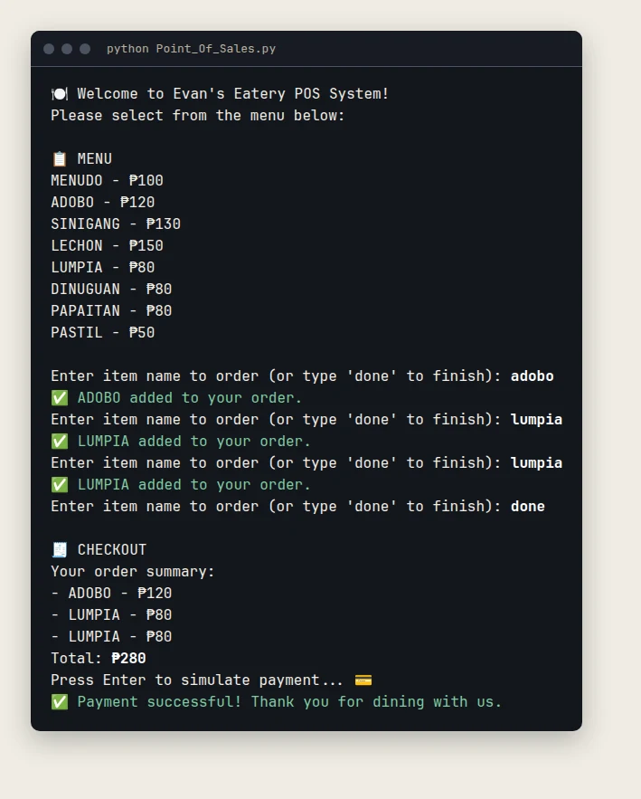

<div align="center">

# Point of Sales: Evan's Eatery

**A Python terminal program that takes a food order, adds it up and simulates payment.**


[](LICENSE)



<sub>A sample order, run from the program.</sub>

</div>

## Contents
- [About](#about)
- [Features](#features)
- [Run it](#run-it)
- [Example session](#example-session)
- [What I would change today](#what-i-would-change-today)
- [Notes](#notes)
- [License](#license)
- [Author](#author)

## About
A practice project from my first year of BSIT. It prints a menu, takes orders and prints an itemised checkout. The menu is a dictionary in `Point_Of_Sales.py`, and the code uses loops, conditionals, functions and f-strings.

## Features
- Prints a menu of eight dishes with prices in pesos.
- Takes orders: type a dish name in any case, and type `done` to finish. A name that is not on the menu is rejected and you are asked again.
- Adds up the order and prints an itemised checkout.
- Press Enter to simulate payment. No real payment happens.

| Dish | Price |
|---|---|
| Menudo | ₱100 |
| Adobo | ₱120 |
| Sinigang | ₱130 |
| Lechon | ₱150 |
| Lumpia | ₱80 |
| Dinuguan | ₱80 |
| Papaitan | ₱80 |
| Pastil | ₱50 |

## Run it
Python 3.6 or newer, no packages. Your terminal needs to show emoji and the peso sign (UTF-8).

```bash
python Point_Of_Sales.py
```

## Example session
What you type comes after each prompt:

```text
Enter item name to order (or type 'done' to finish): adobo
✅ ADOBO added to your order.
Enter item name to order (or type 'done' to finish): lumpia
✅ LUMPIA added to your order.
Enter item name to order (or type 'done' to finish): lumpia
✅ LUMPIA added to your order.
Enter item name to order (or type 'done' to finish): done

🧾 CHECKOUT
Your order summary:
- ADOBO - ₱120
- LUMPIA - ₱80
- LUMPIA - ₱80
Total: ₱280
Press Enter to simulate payment... 💳
✅ Payment successful! Thank you for dining with us.
```

## What I would change today
- Ordering the same dish twice adds two lines. A quantity prompt would be cleaner.
- Payment is only a keypress. It should ask for the amount handed over and give change.
- `checkout()` reads the global `menu`, and the program runs as soon as the file loads. A `main()` function behind an `if __name__ == "__main__":` check would let the functions be tested on their own.

## Notes
`Point_Of_Sales.py` used to sit inside a second `Point_Of_Sales/` folder. It now lives at the repository root. A header and comments were added. The only code change is the menu spelling: dinuguan was typed `DINIGUGAN`, so ordering it by its usual name failed.

## License
Released under the [MIT License](LICENSE).

## Author
**Evan Prens P. Exanes** · [GitHub](https://github.com/evanexanes) · [Portfolio](https://evanexanes.github.io/)
